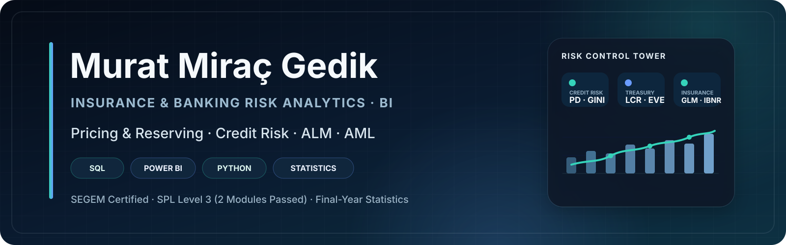

  

  
  
  

  
  
  
  
  

  <b>Final-year Statistics student building a career in insurance and banking analytics: pricing and reserving, credit and balance-sheet risk, financial crime, and decision-support reporting.</b>

 

  

I am a **final-year Statistics student at Süleyman Demirel University** (graduating June 2027). I combine statistical modelling with insurance and banking domain knowledge: I hold the **SEGEM Insurance Technical Personnel certificate** and have passed **two SPL Level 3 capital-markets licence modules**.

My portfolio turns financial and operational data into **pricing indications, reserve estimates, risk indicators, explainable models and executive dashboards**. The strongest areas are **motor insurance pricing and claims reserving, credit risk, Treasury & ALM / IRRBB, and AML/KYC**. Running my own e-commerce business for several years taught me to tie analysis to profitability, pricing and operational constraints.

> **Portfolio transparency:** Unless a repository explicitly states otherwise, its datasets and business outputs are synthetic or controlled. They demonstrate methodology, validation, engineering quality and business interpretation, not real customer or institutional data.

<table>
  <tr>
    <td align="center" width="25%"><b>🛡️ Insurance</b> GLM pricing · Chain Ladder · BF · Parametric</td>
    <td align="center" width="25%"><b>🏦 Banking & Risk</b> Credit Risk · ALM/IRRBB · AML/KYC</td>
    <td align="center" width="25%"><b>📊 BI & Reporting</b> Power BI · DAX · Excel · SQL</td>
    <td align="center" width="25%"><b>🧠 Analytics</b> Python · Statistics · ML · SHAP</td>
  </tr>
</table>

 

  

<table>
  <tr>
    <td width="50%" valign="top">
      
      <h3><a href="https://github.com/muratmiracg-dev/motor-insurance-pricing-claims-reserving-platform">Motor Insurance Pricing, Claims & Reserving</a></h3>
      Poisson and Gamma GLMs for frequency and severity, technical premium indication, Chain Ladder and Bornhuetter-Ferguson reserving, and explainable fraud triage with human review. 
      <b>60,000 policies · 72.2% loss ratio · 0.982 OOT frequency calibration · BF IBNR TRY 160.0M</b>
    </td>
    <td width="50%" valign="top">
      
      <h3><a href="https://github.com/muratmiracg-dev/Banking-Credit-Risk-Explainable-Loan-Decisioning-Platform">Credit Risk & Explainable Loan Decisioning</a></h3>
      12-month PD model with out-of-time validation, PD-to-score bands, exact Linear SHAP reason codes, a fairness audit and PSI drift monitoring. 
      <b>48,000 applications · 0.738 OOT ROC AUC · 0.475 Gini · 0.981 calibration slope</b>
    </td>
  </tr>
  <tr>
    <td width="50%" valign="top">
      
      <h3><a href="https://github.com/muratmiracg-dev/aurelia-bank-treasury-alm-risk-control-tower">Treasury & ALM Risk (IRRBB, Liquidity, FX)</a></h3>
      Repricing and maturity gaps, six Basel EVE shocks without cross-currency offset, NII sensitivity, LCR/NSFR proxies under liquidity stress, and FX hedge analysis for ALCO. 
      <b>TRY 180B balance sheet · worst EVE loss 13.9% of Tier 1 · combined-stress LCR 94.8%</b>
    </td>
    <td width="50%" valign="top">
      
      <h3><a href="https://github.com/muratmiracg-dev/aurelia-bank-financial-crime-aml-intelligence-control-tower">Financial Crime & AML Intelligence</a></h3>
      KYC risk scoring, transaction-monitoring scenarios, behavioural anomaly detection and graph analytics feeding explainable alert triage and human-led case operations. 
      <b>48,412 transactions · 134 explainable alerts · 98.91% recall · 67.91% precision</b>
    </td>
  </tr>
</table>

 

### 🔬 Research: Parametric insurance for solar power plants

**TÜBİTAK 2209-A undergraduate research project (in progress).** Compares a traditional irradiance-based parametric insurance index with a machine-learning production index for solar power plants in Konya, Niğde, Karaman and Sivas, and measures how much **basis risk**, the gap between index payouts and actual production losses, each design leaves.

- Hourly plant-level generation from the EPİAŞ Transparency Platform; NASA POWER and ERA5-Land meteorology.
- OLS, Ridge and Random Forest production models; basis risk scored with an asymmetric error that penalises under-payment more than over-payment; designs compared at equal premium budget.
- Sensitivity to the meteorological data source, the training period and the payout trigger.

 

  

| Project | Primary focus |
|---|---|
| [Pension (BES) Fund Intelligence](https://github.com/muratmiracg-dev/aurelia-pension-bes-fund-intelligence) | Peer-relative fund performance, portfolio risk, stress tests, contribution simulations |
| [SME Relationship & Sales Intelligence](https://github.com/muratmiracg-dev/aurelia-bank-sme-relationship-sales-intelligence-control-tower) | Customer 360, product propensity, uplift, next-best conversation |
| [Banking Complaint Intelligence & Early Warning](https://github.com/muratmiracg-dev/banking-complaint-intelligence-early-warning) | NLP on CFPB complaints, topic discovery, statistical early warning |
| [Financial Reconciliation & Controls Engine](https://github.com/muratmiracg-dev/financial-reconciliation-controls-engine) | Bank–invoice–ledger matching, exception management, audit trail |
| [Customer Intelligence, CLV & Churn Prediction](https://github.com/muratmiracg-dev/customer-intelligence-clv-churn-prediction-platform) | Segmentation, CLV, churn, retention analytics |
| [Integrated FP&A, Budgeting & Scenario Planning](https://github.com/muratmiracg-dev/integrated-fpa-budgeting-forecasting-scenario-planning) | Budgeting, rolling forecasts, scenarios, Monte Carlo |
| [CRM Sales Analytics & BI Dashboard](https://github.com/muratmiracg-dev/crm-sales-analytics-bi-dashboard) | Executive BI, funnel, pipeline, sales performance |
| [E-Commerce Demand Forecasting & Inventory Optimization](https://github.com/muratmiracg-dev/ecommerce-demand-forecasting-inventory-optimization) | Forecasting, replenishment, inventory planning |
| [Enterprise Process Mining & Workflow Optimization](https://github.com/muratmiracg-dev/Enterprise-Process-Mining-Intelligent-Workflow-Optimization) | Process mining, conformance, SLA risk, capacity simulation |
| [Manufacturing Quality, OEE & Predictive Maintenance](https://github.com/muratmiracg-dev/Manufacturing-Quality-OEE-Predictive-Maintenance-Control-Tower) | OEE, SPC, quality, reliability, predictive maintenance |
| [Geospatial Site Selection & Market Expansion](https://github.com/muratmiracg-dev/geospatial-site-selection-market-expansion-intelligence) | Geospatial scoring and expansion decision support |

<b>Cloud & engineering projects</b>

 

| Project | Primary focus |
|---|---|
| [Huawei Cloud DevSecOps CI/CD Platform](https://github.com/muratmiracg-dev/huawei-cloud-devsecops-cicd-platform) | DevSecOps, CI/CD, testing and deployment |
| [Huawei Cloud FinOps Capacity Optimization](https://github.com/muratmiracg-dev/Huawei-Cloud-FinOps---Intelligent-Capacity-Optimization) | Cloud cost and capacity optimization |
| [Huawei Cloud Native AIOps & Observability](https://github.com/muratmiracg-dev/huawei-cloud-native-aIops-observability---automated-incident-response-platform) | Observability and automated incident response |

 

  

### Insurance, Banking & Risk Domains

  
  
  
  
  
  
  

### Analytics & BI

  
  
  
  
  
  
  

### Engineering & Delivery

  
  
  
  

 

  

| Organization | Role | Period |
|---|---|---|
| **Social Office** (TNC Group Companies) | Sales & Marketing Intern | Jul–Sep 2026 |
| **Arch of Sigma** (TNC Group Companies) | Information Technology Intern | Jun–Jul 2026 |
| **Alignerr** | E-Commerce Data Analyst (contract) | Mar–Aug 2026 |
| **Albaraka Türk** | Banking & FinTech Intern (Albaraka Garaj) · Young Development Program | Oct 2025–Jan 2026 |
| **Monaco Luxe Clothing** | Founder & E-Commerce Operations Manager (TRY 100K–500K annual revenue) | 2020–Aug 2026 |
| **Gülcan Metal Sanayi ve Ticaret** | Sales, Operations & Production Assistant | Jul–Sep 2024 |

Full experience details are on <a href="https://www.linkedin.com/in/muratmiracgedik/">LinkedIn</a>.

 

  

<table>
  <tr>
    <td width="50%" valign="top">
      <h3>🎓 Education</h3>
      <b>B.Sc. Statistics</b> 
      Süleyman Demirel University 
      Sep 2023 – Jun 2027 (expected) · Board member, Statistics & Data Science Society  
      <b>Financial Engineering</b> — online certificate program 
      Columbia University
    </td>
    <td width="50%" valign="top">
      <h3>🏅 Licences & Certifications</h3>
      <b>SEGEM Insurance Technical Personnel Qualification</b> — Obtained (Sep 2026) 
      <b>SPL Level 3</b> — 2 modules passed; preparation continues 
      Derivatives Instruments Licence · Private Pension System (BES) — preparation in progress  
      <b>Professional certificates:</b> Anaconda Python for Data Science · Wolfram Machine Learning Statistical Foundations · CSCMP Demand Planning · NASP Sales Foundations  
      <b>Programs:</b> KOSGEB Entrepreneurship · Albaraka Garaj · AI & Technology Academy (Technology Entrepreneurship) · Ford Otosan Career & Development Week · OSD Automotive Summer Camp
    </td>
  </tr>
</table>

**Languages:** Turkish (native) · English (professional working proficiency)

 

  

  <b>Open to insurance, banking, risk and BI analytics internships and graduate opportunities.</b>

  
  

